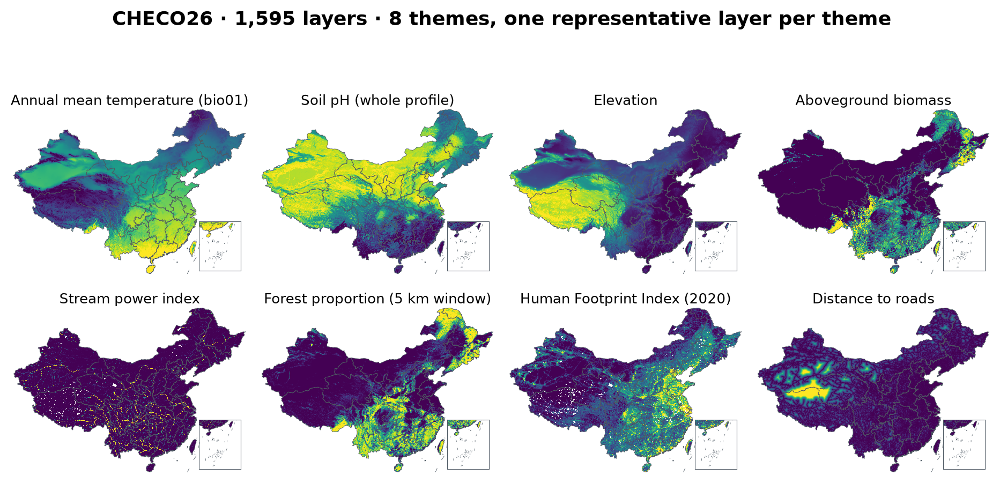
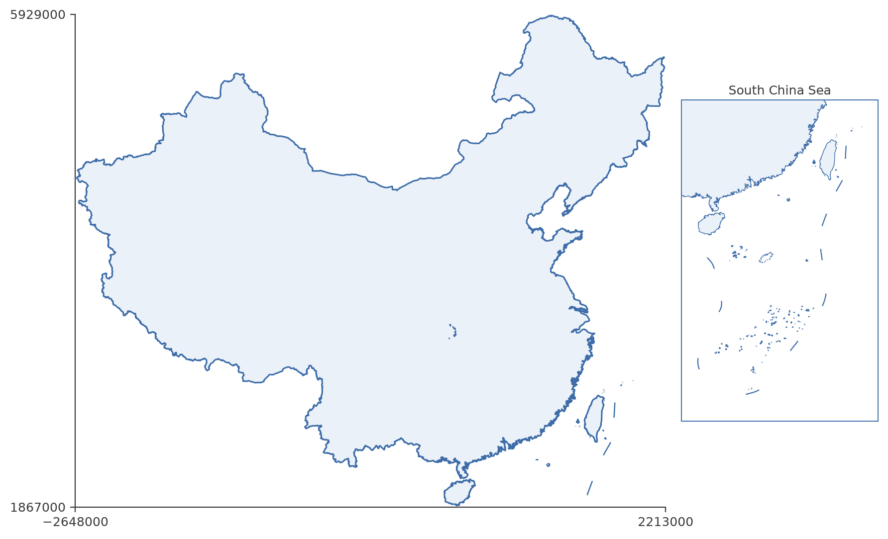

# CHECO26

<a href="LICENSE"></a>
<a href="data/CHECO26_datalayers_details.csv"></a>
<a href="database_validation/"></a>
<a href="database_validation/"></a>

CHECO26 is a China-wide raster database at 1-kilometre resolution for ecological research, gathering **21,788 layers** in **25 dataset entries** drawn from **19 distinct source products** across **eight environmental categories**. (GHS-SMOD and Hydrography90m each enter under two categories, so the entry count exceeds the product count.) CHECO26 layers were standardized to a common spatial grid covering all of China, so they all share the same spatial resolution, extent, and geographic coordinate system. CHECO26 includes both the standardized source data and newly calculated layers, such as those obtained by computing focal statistics, distance surfaces, and discrete-to-continuous landscape derivations. The database is designed as a ready-to-use environmental covariate base for species distribution modelling and other cross-thematic ecological applications.

The [detailed list](https://github.com/EldonQ/CHECO26/blob/main/data/CHECO26_datalayers_details.csv) of every layer present in CHECO26 is available in this repository — one semicolon-separated row per delivered layer, with category, dataset, variable, period, scenario, year range, focal radius, physical unit and path. The database is described in a data manuscript currently in preparation.

<p align="center">
  
</p>

## Spatial characteristics


| Parameter  | Value |
| ------------- | ------------- |
| GCS                         | China_Albers (WGS84, standard parallels 25N / 47N, central meridian 105E) |
| Extent                      | -2648000, 1867000, 2213000, 5929000 |
| Grid                        | [CHECO26 standard grid](https://github.com/EldonQ/CHECO26/blob/main/data/CHECO26-standardgrid.tif) |
| Spatial resolution (meters) | 1000, 1000  (x, y) |
| Grid size                   | 4861 columns x 4062 rows |
| Valid cells (China mask)    | 9,490,310 of 19,745,382 (48.1%) |
| Mask                        | [mask_china.tif](https://github.com/EldonQ/CHECO26/blob/main/data/mask_china.tif), `china.shp` rasterized `all_touched=True` (islands and coastlines kept) |
| Data type                   | float32, every layer without exception |
| NoData                      | -9999, every layer |
| Storage                     | GeoTIFF, DEFLATE compressed, 256 x 256 tiles |
| Volume                      | 183.1 GB (170.6 GiB) |

## Layer inventory

| Category | Layers | Content |
|---|---:|---|
| lulc | 20,150 | Three complementary products: **clcd** annual observed cover 2000–2025 (1,170 = 26 years x 9 classes x 5 scales) · **glu1km** China-relevant projection 2020 + 2030/2050/2100 under three SSPs (540) · **hlu1km** harmonised yearly reconstruction 1960–2020 plus 2021–2100 under five SSP-RCPs (18,440) |
| bioclim | 1,210 | **CHELSA v2.1** 22 present layers (bio01–19 + gdd0/5/10, 1981–2010) plus six future chains — five CMIP6 GCMs (GFDL-ESM4, IPSL-CM6A-LR, MPI-ESM1-2-HR, MRI-ESM2-0, UKESM1-0-LL) and their equal-weight ensemble mean — at 2025/2055/2085 under SSP1-2.6/3-7.0/5-8.5 (6 × 198) |
| soil | 196 | **csdlv2** 28 attributes x (six standard depths + one whole-profile aggregate) |
| anthro | 137 | **hfp** annual Human Footprint 2000–2024 x 5 scales (125) · **smod** built-up proportion 1975–2030 x 12 epochs (12) |
| hydro | 44 | **h90m** 39 continuous Hydrography90m layers · **hydrosheds** 5 flow-accumulation layers |
| vege | 30 | forest aboveground biomass (**agb2019**), forest canopy height (**ch2019**), tree canopy cover (**catcd**), GLASS NDVI 2020–2022 (**glassndvi**), each with focal windows |
| dist | 17 | distance to roads and major roads (**grip4**), trails (**osm**), urban areas (**smod**), surface water (**gsw**), and four stream-distance surfaces (**h90m**) |
| topo | 4 | elevation, slope, aspect, terrain ruggedness index (**chinadem**) |
| **Total** | **21,788** | **25 dataset entries from 19 source products** |

Of the 21,788 layers, 5,502 are delivered at the native 1-km resolution and 16,286 are focal variants — 4,064 at 1 km and 4,074 at each of 5, 10 and 20 km. 3,982 of the native-resolution layers are class proportions; the remaining 1,520 are source layers plus 18 multi-source extrema. 17,674 layers describe a future scenario and 4,114 describe the present. Every one of these counts is reproducible from the manifest's `focal`, `attribute` and `period` columns.

## Layer processing

Individual layers from the selected source products were processed following a
fixed, variable-type-driven standardization procedure:

1. rasterization of vector layers (roads, trails, water bodies, urban areas, stream networks)
2. reprojection to the China_Albers equal-area geographic reference system
3. resampling to the common 1-km grid — `bilinear` for continuous, proportion and distance layers; `nearest` for categorical layers; `average` / `mode` window aggregation when downscaling fine-resolution sources (30 m / 90 m)
4. transformation of discrete data to continuous ones — land-cover classes become class proportions, edge density, Shannon diversity, and patch density / mean patch size over square windows
5. computation of distance statistics for linear and areal features (Euclidean distance, metres)
6. computation of focal statistics — equal-weight means over four square windows (3 x 3 to 41 x 41 cells, i.e. 1, 5, 10 and 20 km radii); a window containing no valid cell receives NoData rather than zero
7. unification of the 13 NoData conventions found in the sources (18 declarations, including 0, 255, 65535, -9999, NaN and ±inf) to -9999, setting class-0 source pixels to NoData before aggregation where 0 doubles as both a class value and the background
8. clipping to the national boundary with an `all_touched` mask (no delivered layer holds valid cells outside China)
9. saving the final raster layers as float32 GeoTIFF (DEFLATE, 256 x 256 tiled, atomic write)

For the standardization rules, the focal-window semantics and the distance-surface
method, see the three R worked examples (they call the production functions directly) in
[`layer_standardization_example/`](layer_standardization_example/),
[`focal_statistics_example/`](focal_statistics_example/) and
[`distance_layers_example/`](distance_layers_example/). The complete production
pipeline is in [`pipeline_r/`](pipeline_r/).

## Data availability

CHECO26 is a database of 183.1 GB and 21,788 float32 GeoTIFF layers on the China_Albers
1-km grid. It is described in a data manuscript currently in preparation and is not yet
publicly released. This repository provides everything needed to
understand, audit and reproduce the database:

- the full layer manifest ([`data/CHECO26_datalayers_details.csv`](data/CHECO26_datalayers_details.csv), one row per layer with category, dataset, variable, period, scenario, year range, focal radius, unit and path),
- the standard grid and China mask,
- nine representative sample layers under [`data/sample_layers/`](data/sample_layers/),
- the production pipeline ([`pipeline_r/`](pipeline_r/)) and its configuration,
- the validation code and a summary of the checks ([`pipeline_r/scripts/tools/`](pipeline_r/scripts/tools/) and [`database_validation/`](database_validation/)).

## Data validation

Every delivered layer is checked for grid invariants (China_Albers, 1,000 m,
4,861 × 4,062), format (float32, NoData −9999, DEFLATE, 256 × 256 tiles), mask
compliance (no valid cell outside China), value range, and agreement with the
variable dictionary and the SHA-256 manifest. The database is consistent four
ways — disk = manifest = provenance = variable dictionary — at **21,788 layers**.

The bioclim theme (1,210 CHELSA v2.1 layers) passes a dedicated acceptance,
`pipeline_r/scripts/tools/accept_chelsa.R` (20 checks, 0 failures), covering
per-layer geometry / mask / NoData / value range and standard WorldClim calibre
for bio02/03/05/06. The other 20,578 layers were validated by an exhaustive
every-pixel audit (Python + rasterio, independent of the R + terra production
validator) and are unchanged.

Counting distinct SHA-256 digests, 14,728 of the 21,788 layers are byte-distinct
(67.6%); the redundancy is confined to the projected land-use family, where the
projected urban extent is frozen across scenarios.

Validation code is in [`pipeline_r/scripts/tools/`](pipeline_r/scripts/tools/)
(`accept_chelsa.R`, `check_table2.R`, `check_docs_consistency.R`,
`verify_independent.R`); the checks and known source-level limitations are
summarised in [`database_validation/README.md`](database_validation/README.md).

## Running the code

Two things run without the 183.1 GB archive:

- **The three worked examples** in `layer_standardization_example/`, `focal_statistics_example/`
  and `distance_layers_example/`. They are R scripts that call the production functions from
  `pipeline_r/scripts/01_common.R` -- the same code that produced the archive, with parameters
  read from `pipeline_r/config.yaml` rather than restated. They need R with `terra` and `yaml`,
  use only the public files in `data/`, and each ends with a check: the focal example
  recomputes two delivered focal layers cell by cell (maximum difference 3.0e-8, i.e. float32
  rounding, and one of them exercises the wide-window code path), the standardization example
  applies the CHELSA scale/offset to a raw 30 arc-sec climate source and reprojects it onto
  the grid, reproducing the delivered layer (sd 0.40 degC, no systematic offset), and the distance example rebuilds the settlement
  distance surface from the GHS-SMOD source (97.9% of the delivered feature cells recovered,
  mean distance difference 69 m) while verifying the distance transform itself against
  closed-form Euclidean values (maximum error 0.002 m).
- **The figure scripts** in `pipeline_r/scripts/figs/`, which need `terra` and the delivered
  layers.

The production pipeline in `pipeline_r/scripts/` is distributed for inspection. Running it
requires the delivery tree, because the stage scripts expect `CHECO_ROOT` to hold `R/` and
`data/`:

```
export CHECO_ROOT=/path/to/delivery        # Windows: set CHECO_ROOT=E:\path\to\delivery
cp -r pipeline_r/scripts   $CHECO_ROOT/R
cp    pipeline_r/config.yaml $CHECO_ROOT/scripts/config.yaml
Rscript $CHECO_ROOT/R/run_all.R            # idempotent; CHECO_FORCE=1 rebuilds
```

Requirements: R 4.4.3, terra 1.8.54 (GDAL 3.10.1), `sf`, `exactextractr`. A full rerun needs
about 210 GB for the layers and 500 GB of scratch space, with the temporary directory on a
data disk rather than the system disk.

## Repository layout

| Directory | Content |
|---|---|
| [`data/`](data/) | layer manifest, standard grid, China mask, sample layers |
| [`pipeline_r/`](pipeline_r/) | **production pipeline (R)** — stage scripts 00–16 plus CHELSA production/metadata entry points, tools, 70 tests, figure scripts, configuration |
| [`database_validation/`](database_validation/) | summary of the validation checks and known source-level limitations |
| [`layer_standardization_example/`](layer_standardization_example/) | standardization worked example (R, calls production `warp_to_template()`) |
| [`focal_statistics_example/`](focal_statistics_example/) | focal-window worked example (R, calls production `focal_all()`) |
| [`distance_layers_example/`](distance_layers_example/) | distance-surface worked example (R, calls production `dist_from_feature()`) |
| [`figs/`](figs/) | README figures |

The delivered rasters are not in this repository: 183.1 GB cannot live in git.
What ships here is the layer manifest, the grid definition, the pipeline that
produced the layers, and the validation evidence — enough to understand, audit
and reproduce the database without holding a copy of it.

## Citation

A data manuscript describing CHECO26 is in preparation. Until it is available,
please cite the database through this repository:

CHECO26: A China-wide cross-thematic raster database at 1-km resolution for ecological research. https://github.com/EldonQ/CHECO26
