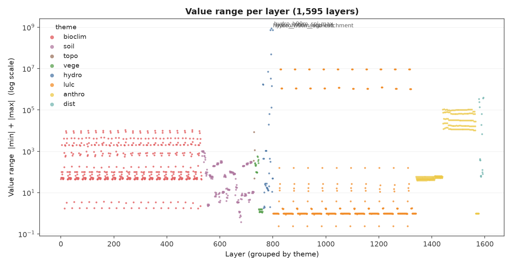
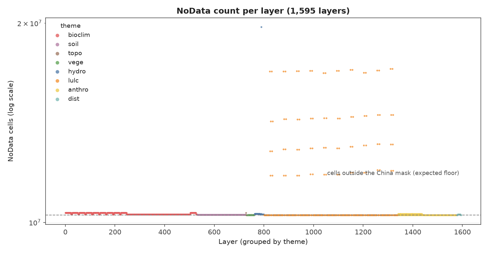
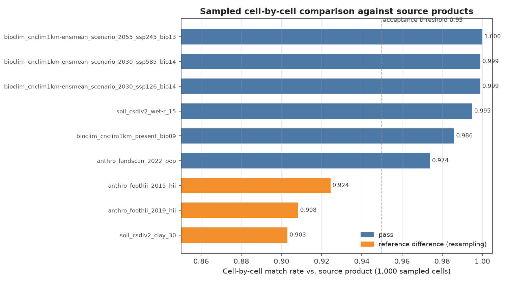

# Data integrity check and effects of resampling operations

This directory contains the validation code, result dataframes and figures for
the CHECO26 raster database. It mirrors the validation module of SWECO25 and
extends it with the derived-layer gates and source-defect forensics that a
1-km national database assembled from heterogeneous products requires.

# 1) Data integrity check

The goal of this analysis is to ensure the consistency and quality of every
CHECO26 layer. The full-library validator
([`script/database_validation.py`](script/database_validation.py)) is driven
only by public artefacts: the layer manifest
([`data/CHECO26_datalayers_details.csv`](../data/CHECO26_datalayers_details.csv)),
the standard grid ([`data/CHECO26-standardgrid.tif`](../data/CHECO26-standardgrid.tif))
and the China mask ([`data/mask_china.tif`](../data/mask_china.tif)).

## Gates and results

All gates are hard; the delivered tree passes all of them
([`result_dataframe/validation_summary.csv`](result_dataframe/validation_summary.csv)):

| Gate | Check | Result |
|---|---|---|
| Existence | every manifest layer on disk; no extra `.tif` | expected = disk = 1,595; missing = 0; extra = 0 |
| Alignment | CRS, resolution, extent, grid origin vs. standard grid | 0 failures (1,595 / 1,595) |
| China mask | no layer holds valid cells outside the national boundary | 0 layers (mask = 9,490,310 cells) |
| Naming | folder names carry no underscore; file name = folder names joined by underscores plus an allowed suffix; depth 4–7; globally unique file names | 0 errors |
| Values | per-layer dtype, nodata, valid-cell count, NA fraction, min, max | recorded in `p5_validation_report.csv` |

Per-layer statistics are available in
[`result_dataframe/p5_validation_report.csv`](result_dataframe/p5_validation_report.csv)
(1,595 rows: `relpath`, `aligned`, `dtype`, `nodata`, `n_valid`, `na_frac`,
`vmin`, `vmax`, `error`).

## Value ranges and NoData counts

|  |  |
|:---:|:---:|

Extreme value ranges and NoData counts were investigated individually and are
all justified by the nature of the data:

- **Hydrography90m long tails.** `spi_max` reaches 8.7 × 10^8 and `sti` /
  `spi` means reach ~5 × 10^7: the stream-power and sediment-transport indices
  carry long right tails in the source product, which are preserved faithfully
  (documented source characteristics, not processing defects).
- **Network index layers.** `segment` and `sub-catchment` use large integer
  identifiers (up to 7.3 × 10^8); these are indices, not continuous gradients,
  and are flagged in the manifest (`sdm_note`) as unsuitable as ordinary SDM
  predictors.
- **`patchsize-all`** reaches 9.4 × 10^6 km², the whole-country patch of the
  41 × 41-cell window in homogeneous regions; the bound gate caps it at the
  mask area (9,490,310 km²).
- **`outlet`** is a sparse basin-outlet marker layer (18,551 valid cells, all
  equal to 1.0): 99.9 % NoData is expected and the layer is flagged as not a
  modelling covariate.
- **Forest-specific patch metrics** (`patchdensity-forest`, `patchsize-forest`)
  are NoData wherever the window contains no forest patch anchor; under the
  most forest-poor future scenarios (SSP585, 2100) this reaches ~86 % of
  cells, consistent with the anchor approximation documented in the pipeline
  configuration.

Median valid-cell shortfall against the China mask is 0.00–0.54 % per theme,
reflecting within-China NoData of the source products (e.g. CNClim1km invalid
patches); no layer exceeds the mask.

# 2) Effects of resampling operations

We assessed the fidelity of the warp-to-template step by comparing 1,000
randomly sampled valid cells of delivered layers against the corresponding
source products (source values read at the target cell centres in the source
CRS, after applying the documented unit scale). A cell counts as matching when
the absolute difference stays within 5 % of the source maximum; a layer passes
at ≥ 95 % matching cells
([`script/database_validation.py`](script/database_validation.py), sampled
cell check; results in
[`result_dataframe/cell_by_cell_checks.csv`](result_dataframe/cell_by_cell_checks.csv)).

| Layer | Match rate | n | Max abs. diff | Verdict |
|---|---:|---:|---:|---|
| `glo_bioclim_cnclim1km_present_bio09` | 0.986 | 1000 | 2.91 | pass |
| `glo_bioclim_cnclim1km-ensmean_scenario_2055_ssp245_bio13` | 1.000 | 1000 | 20.83 | pass |
| `glo_bioclim_cnclim1km-ensmean_scenario_2030_ssp126_bio14` | 0.999 | 1000 | 7.47 | pass |
| `glo_bioclim_cnclim1km-ensmean_scenario_2030_ssp585_bio14` | 0.999 | 1000 | 7.16 | pass |
| `glo_anthro_landscan_2022_pop` | 0.974 | 1000 | 2697.66 | pass |
| `glo_soil_csdlv2_wet-r_15` | 0.995 | 1000 | 11.07 | pass |
| `glo_soil_csdlv2_clay_30` | 0.903 | 1000 | 6.52 | reference difference |
| `glo_anthro_foothii_2015_hii` | 0.924 | 992 | 14.90 | reference difference |
| `glo_anthro_foothii_2019_hii` | 0.908 | 992 | 14.66 | reference difference |



The three sub-threshold layers are **reference differences, not defects**: they
compare a bilinear reprojection against the source product's own resampling at
sharp gradients (footHII index discontinuities, clay content boundaries), where
the two interpolation paths legitimately disagree. The hard acceptance gates
(existence, alignment, mask, naming, value range) all pass, and every layer was
additionally audited cell-by-cell against its source during production without
finding data defects.

# 3) Derived-layer gates

Focal-window and landscape-metric layers carry two failure modes that
existence and alignment checks cannot see, tested by
[`script/validate_derived_layers.py`](script/validate_derived_layers.py):

- **G1 — value range.** A derived layer's `[min, max]` must lie inside its base
  layer's range; a window mean cannot leave the input range.
- **G2 — empty window.** No derived cell may hold a value where its window
  contained zero valid base cells; a focal mean must be NoData there.

Theoretical bounds are additionally enforced for the LULC metrics that are not
focal means of a single base: Shannon diversity ≤ ln(6), edge density ∈ [0, 1],
patch density ≥ 0, patch size ≤ mask area.

These gates were added after a real defect was found: the empty-window test
originally relied on a floating-point validity mean whose rounding residue
(~10^-17) is non-zero, so fully empty windows produced garbage values (242
focal layers carried values up to 4,384 against a base range of 0–63.7). The
corrected integer-count criterion was verified against exact counts for all
four window sizes, and **524 derived layers were rebuilt** on 2026-10-06
(203,407 garbage cells → 0; per-layer before/after evidence in
[`result_dataframe/focal_repair_record.csv`](result_dataframe/focal_repair_record.csv)).
Layers with at least one valid cell in the window are bit-identical to the
previous implementation.

# 4) Withdrawn layers (source defects)

On 2026-10-06, eight Hydrography90m layers were withdrawn from the delivery
tree (1,603 → 1,595) because the **source product values are unusable**, not
because of any processing defect:
[`result_dataframe/withdrawn_layers_manifest.csv`](result_dataframe/withdrawn_layers_manifest.csv).

| Layer | Source-side evidence |
|---|---|
| `cti` | int32 range [−5.7 × 10^8, 1.9 × 10^9]; ln(a/tanβ) cannot reach that magnitude; 99.7 % of cells negative |
| `channel_grad_{dw_seg,up_cel,up_seg}` | median ~9 × 10^4 cm/m, max 1.4 × 10^9; physical upper bound ~100 cm/m |
| `slope_curv_{max,min}_dw_cel` | symmetric saturation at ±384,900 |
| `accumulation` (+ `_max`) | contains negative values although the unit is km² |

For each withdrawn layer, the delivered raster was re-projected from the source
with the identical pipeline rule (average downscaling) and compared
cell-by-cell: the value-range upper bounds agree to float32 bit level and zero
cells differ by more than 1 % — the delivered layers are faithful downscalings
of defective sources, so re-running cannot repair them. They are archived with
a one-command rollback path.

# 5) Reproducing

```console
# full-library integrity check (existence / alignment / mask / naming / values)
python script/database_validation.py \
    --root      path/to/delivery_tree \
    --manifest  ../../data/CHECO26_datalayers_details.csv \
    --grid      ../../data/CHECO26-standardgrid.tif \
    --mask      ../../data/mask_china.tif \
    --output    validation_report.csv

# derived-layer gates (value range + empty window + LULC bounds)
python script/validate_derived_layers.py \
    --root  path/to/delivery_tree \
    --mask  ../../data/mask_china.tif \
    --output derived_validation_report.csv

# regenerate the figures from the result dataframes
python script/make_validation_figures.py
```

The production pipeline that builds the database from source products is in
[`../pipeline/`](../pipeline/); the validation scripts here are self-contained
re-implementations of its acceptance gates (production modules `08` and `10`),
driven only by the public artefacts of this repository.
